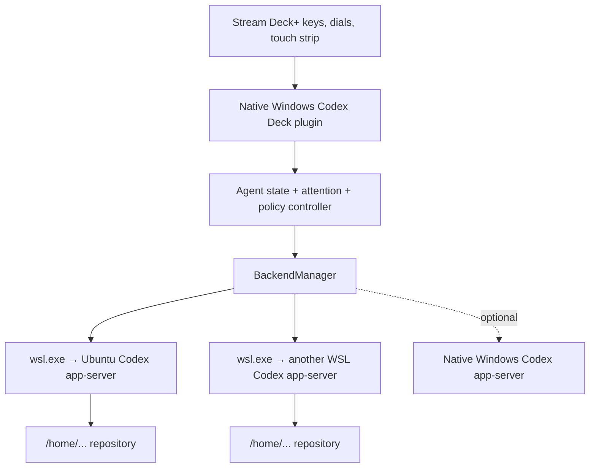

# Codex Deck

Codex Deck turns an Elgato Stream Deck+ into a WSL2-first operations console for
multiple Codex agents. The native Windows plugin owns the hardware while each
configured WSL distribution runs its own authenticated `codex app-server` and
Linux-native repositories.

The MVP is designed around six persistent agent slots, an attention-aware
Proceed/Approve key, a deliberate Decline/Stop key, four contextual dials, and
touch-strip feedback. It does not scrape a terminal, inject keystrokes, emulate
Codex Micro USB hardware, or read Codex credentials.

## MVP status

Implemented in `0.2.0`:

- Native Windows Stream Deck SDK v3 plugin.
- WSL distribution discovery and exact-name validation.
- Fixed-command Codex preflight and shell-free `wsl.exe` app-server launch.
- One reusable app-server connection per WSL distribution.
- Six backend-bound agent slots with persisted thread identity.
- Thread start/resume, prompt turns, model discovery, reasoning selection, and
  workflow presets.
- Runtime, workflow, verification, unread, health, and approval state.
- Connection-bound approvals with risk classification and hold-to-confirm.
- Fail-closed handling for permission broadening, MCP elicitation, and questions
  that need the full Codex interface.
- Dynamic key artwork and all four Stream Deck+ encoder feedback segments.
- Native Windows Codex backend as an optional fallback.
- Unit tests, TypeScript checks, Rollup bundle, Elgato validation, and packaging.

Not in this MVP:

- Controlling the exact live task already open in the Windows Codex app.
- M4/SSH Stream Deck control.
- Answering free-form Codex questions from the deck.
- An automatically installed Stream Deck profile.
- Cursor or Claude Code adapters.

## Hardware layout

Create a Stream Deck+ profile with this arrangement:

```text
[ Agent 1 ] [ Agent 2 ] [ Agent 3 ] [ Agent 4 ]
[ Agent 5 ] [ Agent 6 ] [ Proceed ] [ Decline/Stop ]

[ Agent ] [ Reasoning / Model ] [ Workflow ] [ Backend ]
```

| Control | Rotate/tap | Push/hold |
| --- | --- | --- |
| Agent keys | Tap selects and marks results read | Hold starts the configured objective |
| Proceed / Approve | Runs the selected agent when no approval exists | Hold confirms a supported pending approval |
| Decline / Stop | Quick press is intentionally inert | Hold declines a request or interrupts a plugin-owned turn |
| Dial 1 — Agent | Selects among configured agent slots | Push selects; long-touch runs |
| Dial 2 — Reasoning | Rotates reasoning effort | Hold while rotating to change model; click resets to High; long-touch refreshes models |
| Dial 3 — Workflow | Implement, Plan, Debug, Review, Validate, Handoff | Long-touch runs the selected workflow |
| Dial 4 — Backend | Cycles backend groups represented by configured slots | Push or long-touch reconnects |

## Prerequisites

On Windows:

- Windows 10/11 with WSL2; Windows 11 is recommended.
- Elgato Stream Deck software 7.1 or newer.
- Stream Deck+.
- Native Windows Node.js 24 or newer and npm for building the plugin.

Inside the selected WSL distribution:

- Current Codex CLI, authenticated with `codex login`.
- `bubblewrap`, Git, and the project toolchains Codex will use.
- Repositories under a Linux path such as `/home/you/code/project`.

See [Prerequisites](docs/PREREQUISITES.md) for the full environment checklist.

## Build and preflight

Run these commands in **native Windows PowerShell**, not inside WSL:

```powershell
npm ci
npm run check
npm run doctor:wsl -- Ubuntu
npm run pack
```

`doctor:wsl` verifies the selected distribution, resolves Codex inside it,
performs the app-server initialization handshake, and lists the live model
catalog without starting a model turn.

Install the generated `.streamDeckPlugin` package by double-clicking it, or use
a linked development installation:

```powershell
npx streamdeck link com.mahdi.codex-deck.sdPlugin
npm run watch
```

Follow [MVP physical test](docs/MVP_TEST.md) for profile setup and the first
hardware validation sequence.

## Configure an agent slot

Select an Agent Slot in the Stream Deck application and set:

1. Slot number from 1 through 6.
2. A short label.
3. `WSL2` and the exact distribution name reported by `wsl --list --quiet`.
4. An absolute Linux workspace such as `/home/mahdi/code/project`.
5. Workflow preset, reasoning effort, optional model, and objective prompt.
6. Whether a quick tap should run the objective. The safer default is off.

The plugin writes the thread ID and its backend identity together after the
first successful run. Changing the distribution or backend invalidates that
association; a thread ID is never silently reused against another filesystem or
authentication context.

## State model

The key display combines four independent dimensions:

```text
Runtime       idle / running / input / complete / error / offline
Workflow      working / needs input / blocked / review / done / failed
Verification  not run / running / passed / failed / unknown
Attention     read / unread / approval pending
```

Codex Deck appends a small structured status contract only to turns it starts.
This avoids modifying global `AGENTS.md`. A completed task becomes
`VERIFIED` only when its structured result says checks actually passed; a
stopped model is not automatically treated as finished work.

## Safety boundaries

- WSL paths and Windows paths are never translated heuristically.
- User prompts and workspaces are app-server RPC data, never shell fragments.
- The only shell operation is the fixed preflight `sh -lc "command -v codex"`
  after validating the distribution against the installed WSL list.
- App-server traffic remains on inherited stdio; no TCP listener is exposed.
- Writable turns explicitly grant the configured workspace plus Codex's normal
  temporary roots, while tool network access remains disabled in this MVP.
- Read-only workflows use approval policy `never`.
- Command and file approvals are displayed with a risk category and require a
  deliberate hold.
- Permission expansion cannot be approved from the deck.
- Critical-risk commands cannot be approved from the deck; open Codex to review
  them with full context.
- Unknown server requests receive an error rather than a guessed response.
- Logs contain backend health and request category only, not prompts or tool
  payloads.

## Architecture



Detailed contracts remain in [Architecture](docs/ARCHITECTURE.md),
[Workflow](docs/WORKFLOW.md), and [Control map](docs/CONTROL_MAP.md).

## Inspiration and interoperability

This independent implementation takes architectural inspiration from:

- [kyleboddy/codex-streamdeck](https://github.com/kyleboddy/codex-streamdeck):
  Stream Deck+ encoder UX, live model discovery, and connection-bound approval
  research.
- [emollick/codex-stream-deck](https://github.com/emollick/codex-stream-deck):
  project/status semantics, verification-aware state, defensive protocol
  handling, and local-first safety.

Their Windows desktop/shared-server and independent local-server designs are
kept as references rather than merged directly. Codex Deck's distinguishing
boundary is its WSL2-first, backend-aware agent fleet architecture.
