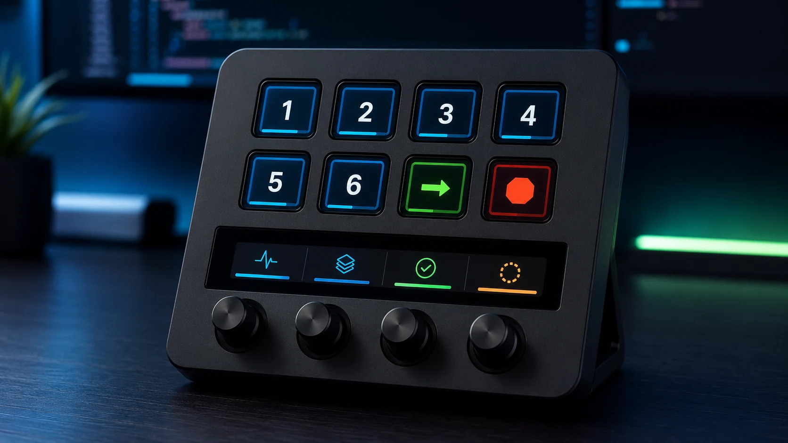
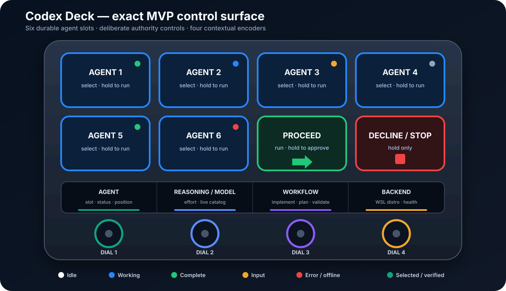
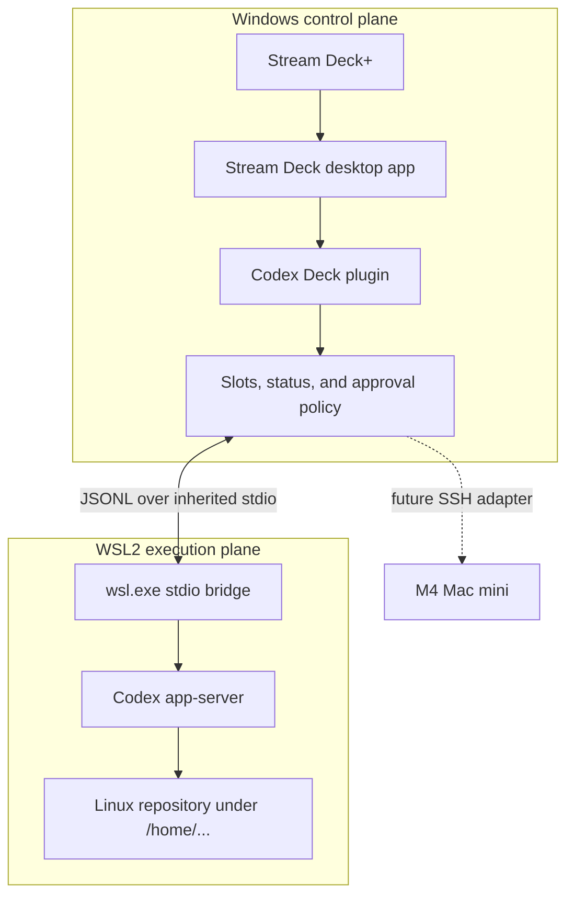
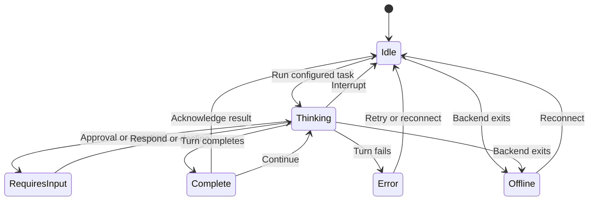
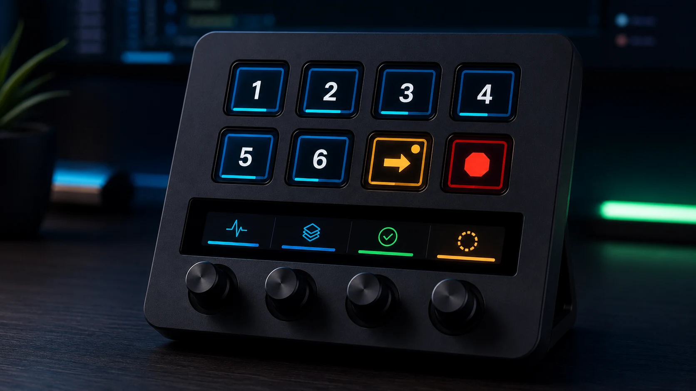

# Codex Deck

> A WSL2-first Stream Deck+ control surface for running and supervising multiple
> Codex agents from a Windows workstation.



_Concept mockup of the intended physical experience. The exact implemented
layout and state colors are documented below._

Codex Deck keeps the Stream Deck plugin native to Windows while running each
coding agent through an authenticated `codex app-server` inside WSL2. It turns
the eight keys, touch strip, and four dials into a compact operations console:
six persistent agent slots, deliberate approval and stop controls, live status,
workflow selection, reasoning/model selection, and backend health.

The MVP does not scrape terminals, inject keystrokes, emulate Codex Micro USB
hardware, or read Codex credentials.

## At a glance

| Item | Current MVP |
| --- | --- |
| Version | `0.2.0` |
| Host | Windows 10/11; Windows 11 recommended |
| Hardware | Elgato Stream Deck+ |
| Primary execution | Codex CLI app-server inside WSL2 |
| Agent capacity | Six persistent, independently configured slots |
| Optional execution | Separate native Windows Codex backend |
| Safety posture | Connection-bound approvals, hold-to-confirm, critical requests fail closed |
| Validation | TypeScript, 28 unit tests, docs/Mermaid validation, Rollup, Elgato manifest validation |

### What is implemented

- Native Windows Stream Deck SDK v3 plugin with dynamic key artwork.
- WSL distribution discovery, exact-name validation, and fixed-command Codex
  preflight.
- Shell-free `wsl.exe` launch of one reusable app-server connection per WSL
  distribution.
- Six backend-bound slots with persisted thread identity and workspace.
- Thread start/resume, prompt turns, live model discovery, reasoning selection,
  and six workflow presets.
- Runtime, workflow, verification, unread, backend-health, and approval state.
- Connection-bound approvals with risk classification and deliberate holds.
- Fail-closed handling for permission expansion, critical commands, MCP
  elicitation, and questions requiring richer input.
- All four encoder actions and four touch-strip feedback regions.
- WSL doctor, physical qualification guide, automated checks, and packaging.

### Deliberately outside this MVP

- Controlling the exact live task already open in the Windows Codex app.
- Remote M4/SSH control from the Stream Deck.
- Free-form answers or forms on the touch strip.
- Automatic Stream Deck profile installation.
- Cursor, Claude Code, or other coding-agent adapters.
- One-tap Git pushes, publishing, messaging, or blanket approval.

## Exact control surface

The illustration below is the source-of-truth control map. Unlike the product
mockups, its labels and colors are exact.



| Control | Rotate or tap | Press, hold, or long-touch |
| --- | --- | --- |
| Agent keys 1–6 | Select slot; acknowledge an unread result | Hold 650 ms to run its configured objective |
| Proceed / Approve | Run or continue when no request is pending | Hold 900 ms to approve an eligible request |
| Decline / Stop | Quick press is intentionally inert | Hold 900 ms to decline a request or interrupt the selected turn |
| Dial 1 — Agent | Select a configured agent slot | Press selects; long-touch runs |
| Dial 2 — Reasoning / Model | Rotate for reasoning; press-and-rotate for model | Press resets to High; long-touch refreshes models |
| Dial 3 — Workflow | Choose Implement, Plan, Debug, Review, Validate, or Handoff | Long-touch runs the displayed workflow |
| Dial 4 — Backend | Cycle distinct configured backends | Press or long-touch reconnects |

## How it works



The plugin owns no TCP listener. It launches the resolved Codex executable
inside the selected distribution and exchanges app-server JSONL over inherited
stdio. User prompts and workspace paths are RPC fields, never shell fragments.
Multiple slots may share a distribution connection while retaining separate
threads.

### Agent lifecycle



Each completion can include a bounded `codex-deck-status` marker. The plugin
uses it to separate a merely completed response from work that was actually
verified. Missing or malformed markers remain `unknown`; they are never guessed
as passing.

## Prerequisites

### Windows host

- Windows 10/11 with WSL2; Windows 11 is recommended.
- Elgato Stream Deck software 7.1 or newer.
- Stream Deck+ connected to the Windows machine.
- Native Windows Node.js 24 or newer, npm, and Git.

### Selected WSL2 distribution

- Current Codex CLI installed and authenticated with `codex login`.
- `bubblewrap`, Git, and the project-specific toolchains Codex will invoke.
- Repositories stored under Linux paths such as `/home/you/code/project`.

The Windows Node runtime builds and runs the plugin. WSL project runtimes run
repository tools. Do not mix those two environments. See the complete
[prerequisite checklist](docs/PREREQUISITES.md).

## Quick start

Run the build and doctor commands in **native Windows PowerShell**, not a WSL
terminal.

```powershell
git clone https://github.com/Mahdi451/codex-streamdeck-plus.git
cd codex-streamdeck-plus
npm ci
npm run check
npm run doctor:wsl -- Ubuntu
npm run pack
```

Replace `Ubuntu` with the exact distribution name printed by:

```powershell
wsl.exe --list --quiet
```

`doctor:wsl` validates the distribution, resolves Codex inside it, performs the
app-server initialization handshake, and reads the live model catalog without
starting a model turn.

Double-click the generated
`com.mahdi.codex-deck.streamDeckPlugin` file to install it. For linked plugin
development instead:

```powershell
npx streamdeck link com.mahdi.codex-deck.sdPlugin
npm run watch
```

Then build the profile described in the
[physical MVP test guide](docs/MVP_TEST.md).

## Configure an agent slot

Add an **Agent Slot** action and configure it in Stream Deck's Property
Inspector:

| Setting | Purpose | Example |
| --- | --- | --- |
| Slot | Stable physical identity from 1 through 6 | `Agent 1` |
| Label | Short project or responsibility name | `API Tests` |
| Backend | WSL2 by default; native Windows is optional | `WSL2` |
| WSL distro | Exact installed distribution name | `Ubuntu` |
| Workspace | Absolute path interpreted by that backend | `/home/mahdi/code/project` |
| Workflow | Prompt contract for the next run | `Implement` |
| Reasoning | Next-turn effort, filtered by model support | `High` |
| Model | Optional live model selection | blank for Codex default |
| Task prompt | Reusable objective for this slot | `Implement and verify the next issue.` |
| Run on tap | Convenience toggle; disabled is safer | `Off` |

After the first successful run, the plugin saves the thread ID together with
its backend identity. Changing the backend or distribution invalidates the old
binding so a thread cannot silently resume against the wrong filesystem or
credentials.

## Approval experience



_Concept mockup of the amber attention state. Actual approval labels include a
bounded origin and risk summary._

| Request class | Hardware behavior |
| --- | --- |
| Ordinary eligible command/file request | Show origin and risk; hold Proceed to approve |
| Decline any supported pending request | Hold Decline / Stop |
| Permission expansion | Cannot be approved from the deck |
| Critical-risk command | Cannot be approved from the deck |
| MCP elicitation or free-form question | Open the full Codex interface |
| Unknown request type | Return an error; never invent a response |

Pending requests retain their backend, connection, thread, turn, request ID,
summary, and risk. Reconnecting invalidates requests from the old connection.
An approval response is accepted only by the exact client instance that
received it.

## Status model

| Dimension | Values represented by the surface |
| --- | --- |
| Runtime | idle, thinking, requires input, complete, error, offline |
| Workflow | working, needs input, blocked, ready for review, done, failed |
| Verification | not run, running, passed, failed, unknown |
| Attention | selected, read, unread, approval pending |
| Backend | Windows or exact WSL distribution identity and health |

The selected slot receives a bright outline. Working is blue, completion is
green, input is amber, and error/offline is red. A separate verification marker
prevents completion color from implying that tests passed.

## Safety boundaries

- WSL and Windows paths are never translated heuristically.
- The selected distribution must match `wsl.exe --list --quiet` exactly.
- The only shell probe is the fixed `sh -lc "command -v codex"` preflight.
- The resolved executable is launched through an argument array.
- App-server communication stays on inherited stdio; no port is opened.
- Writable turns receive the configured workspace plus Codex's normal temporary
  roots; tool network access is disabled by this MVP.
- Plan-only workflows use read-only sandboxing and approval policy `never`.
- Quick presses cannot approve or stop destructive work.
- Prompts, tool payloads, credentials, and repository contents are not logged.

## Codex App versus Codex CLI

This MVP uses `codex app-server`, which is provided by the Codex CLI installed
inside WSL2. The Windows Codex app may coexist and may open the same repository,
but it does not share live control of the plugin-owned thread. Treat the app and
the Stream Deck wrapper as separate clients until a supported shared-session
adapter exists.

## Testing and qualification

```powershell
npm run docs:check  # local links and every Mermaid block
npm run typecheck
npm test            # 28 unit tests
npm run build
npm run validate    # Elgato manifest validation
npm run check       # all checks above
```

Automated checks cover transport framing, initialize ordering, binary
resolution, WSL parsing, Linux path validation, thread/backend isolation,
reconnect-bound approvals, lifecycle status, and structured completion parsing.

Automation cannot replace the target-machine pass. Before real work, complete
the [physical test checklist](docs/MVP_TEST.md) using a disposable repository.

## Troubleshooting

| Symptom | First check |
| --- | --- |
| `doctor:wsl` cannot find the distro | Copy the exact name from `wsl.exe --list --quiet` |
| Codex path or authentication error | Enter that distro and run `codex login status` |
| Workspace rejected | Use an absolute `/home/...` path for WSL slots |
| Codex Deck missing in Stream Deck | Confirm Stream Deck 7.1+, reinstall package, restart Stream Deck |
| Key remains offline | Push Dial 4 to reconnect, then review plugin logs |
| Model list is empty | Long-touch Dial 2 after backend health is connected |
| Approval says `OPEN APP` | The request needs context or input intentionally unavailable on hardware |
| Thread stops resuming after backend change | Expected: backend changes invalidate old thread bindings |

## Repository map

```text
com.mahdi.codex-deck.sdPlugin/  Stream Deck manifest, property inspector, images
src/actions/                    Key and encoder actions
src/backends/                   WSL discovery, transport ownership, approvals
src/codex/                      App-server JSON-RPC client and stdio transport
src/controller/                 Hardware-to-agent orchestration
src/state/                      Lifecycle and verification projection
src/ui/                         Dynamic key artwork
src/dev/                        Console and WSL doctor utilities
test/                           Node test suite
scripts/                        Documentation validation
docs/                           Architecture, workflow, control, and test guides
```

Generated `bin/plugin.js`, `node_modules`, and `.streamDeckPlugin` packages are
excluded from source control and recreated by the build.

## Documentation

- [Prerequisites and environment decisions](docs/PREREQUISITES.md)
- [Architecture and protocol boundaries](docs/ARCHITECTURE.md)
- [Control map and gestures](docs/CONTROL_MAP.md)
- [Runtime workflow and failure behavior](docs/WORKFLOW.md)
- [Windows + WSL2 + physical hardware test](docs/MVP_TEST.md)
- [Release history](CHANGELOG.md)

## Roadmap

1. Qualify v0.2 on the target Windows machine and Stream Deck+.
2. Refine artwork from physical usability feedback and add exportable profiles.
3. Add a supported M4/SSH backend without weakening backend identity rules.
4. Explore richer question handoff and deep links to the full Codex interface.
5. Evaluate adapter boundaries for other coding agents only after the Codex
   control path is stable.

## Inspiration and interoperability

This independent implementation takes architectural inspiration from:

- [kyleboddy/codex-streamdeck](https://github.com/kyleboddy/codex-streamdeck)
  for Stream Deck+ encoder UX, live model discovery, and connection-bound
  approval research.
- [emollick/codex-stream-deck](https://github.com/emollick/codex-stream-deck)
  for project/status semantics, verification-aware state, defensive protocol
  handling, and local-first safety.

Their desktop/shared-server and independent local-server designs remain
references rather than copied implementations. Codex Deck's distinguishing
boundary is its WSL2-first, backend-aware agent-fleet architecture.
