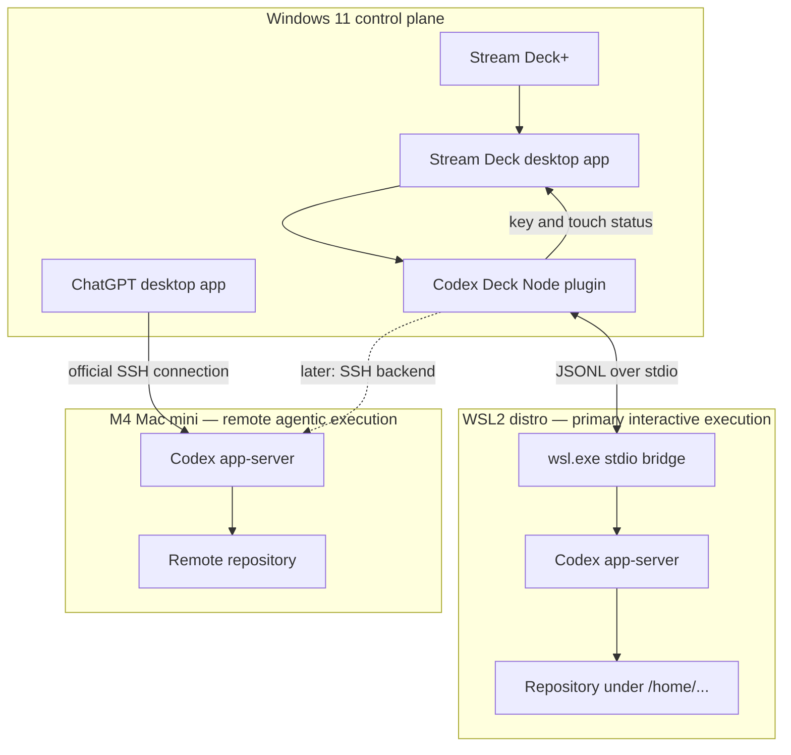

# Architecture

## Target topology



Windows is the control plane. WSL2 and the M4 are execution planes. The Windows
desktop app and Stream Deck plugin may start separate app-server processes; the
diagram shows common environments, not a shared live process.

## WSL2 process contract

The backend performs two stages.

### 1. Preflight

Discover installed distributions with a direct process call:

```powershell
wsl.exe --list --quiet
```

For the chosen distribution, run a fixed login-shell probe to locate Codex:

```powershell
wsl.exe --distribution Ubuntu --exec sh -lc "command -v codex"
```

The implementation must validate that the returned value is one absolute Linux
path with no control characters. The distribution must match an entry returned
by WSL; it is not arbitrary shell text.

### 2. Protocol process

Launch the resolved executable directly so prompts and project paths never enter
a shell command:

```powershell
wsl.exe --distribution Ubuntu --exec /home/<user>/.local/bin/codex app-server --listen stdio://
```

`wsl.exe` carries app-server stdin, stdout, stderr, and exit status. stdout is
protocol-only JSONL; diagnostics stay on stderr. A turn's Linux workspace path
is sent in its app-server request rather than being used to construct the
process command.

## Backend identity

```ts
type BackendTarget =
  | { type: "wsl"; distribution: string }
  | { type: "windows" }
  | { type: "ssh"; host: string };

type SlotAssignment = {
  backend: BackendTarget;
  workspace: string;
  threadId?: string;
  label: string;
};
```

WSL is the default. Native Windows remains a fallback. SSH is reserved for the
M4. The tuple is persisted atomically so a thread ID can never be resumed against
the wrong filesystem or credentials.

## Connection ownership

`BackendManager` owns one app-server client per target identity:

| Target identity | Connection key | Workspace behavior |
| --- | --- | --- |
| WSL2 | Distribution name | Each turn supplies an absolute Linux path. |
| Native Windows | `windows` | Each turn supplies an absolute Windows path. |
| M4 | Concrete SSH alias | Each turn supplies an absolute macOS path. |

Multiple slots may share one WSL app-server connection while retaining separate
thread IDs. A WSL shutdown invalidates the connection, marks associated slots
offline, starts a fresh connection on demand, and resumes persisted threads.

## Separation of concerns

- `BackendManager`: discovery, connection reuse, health, and reconnect policy.
- `WslCodexTransport`: `wsl.exe` process lifecycle and JSONL framing only.
- `StdioCodexTransport`: common local child-process framing.
- `CodexAppServerClient`: handshake, request correlation, events, and methods.
- `AgentStateStore`: converts protocol events to Micro-like states.
- `AgentSlotAction`: maps one key to one backend/workspace/thread tuple.
- `status-image`: renders task state and backend badge.

The property inspector gathers configuration but never launches a backend. User
prompts and workspace paths are RPC data, not command-line fragments.

## Path rules

- WSL slots accept normalized absolute Linux paths beginning with `/`.
- Native slots accept absolute Windows paths and never reuse WSL thread IDs.
- SSH slots accept remote POSIX paths.
- `\\wsl$\...`, `C:\...`, `/mnt/c/...`, and `/home/...` are not silently
  converted into one another.
- Repositories should live under `/home/<user>/...` for WSL performance and
  predictable Linux permissions.

## App-server handshake

For every new WSL connection:

1. Launch the WSL process.
2. Send one `initialize` request.
3. Wait for its response.
4. Send `initialized`.
5. Resume saved thread IDs as their slots become active.
6. Continue consuming notifications and server requests.
7. On exit, reject pending requests and mark every dependent slot offline.

## Approval routing

Every pending request retains:

```text
backend ID + host/distro badge + project + thread ID + request ID + summary
```

WSL approvals route to the user. Eligible M4 approvals may route through Codex
auto-review. Unknown or unresolved requests remain amber. A response is accepted
only by the same client instance that received the request.

## Security boundary

- WSL uses Linux sandboxing with `bubblewrap` installed.
- Local and M4 defaults remain `workspace-write` plus `on-request`.
- `wsl.exe` and `ssh.exe` arguments are arrays passed to direct process launch.
- The only shell probe is a fixed `command -v codex` preflight.
- No app-server listener is exposed to Windows, the LAN, or the internet.
- Logs omit prompts, tool payloads, credentials, and repository contents.

## Versioning rule

Approval payloads, reasoning controls, experimental fields, and new item types
must be implemented against the schema generated by the Codex installation
inside the target WSL distribution. Do not guess response shapes.

## MVP implementation and qualification

Implemented in v0.2:

1. Backend and assignment types.
2. WSL discovery, executable preflight, and shell-free transport.
3. Backend manager, connection-bound approvals, reconnect, and resume.
4. Property Inspector, Linux-path validation, and persistent slot settings.
5. Backend-aware status projection, key badges, dials, and context keys.
6. Automated unit, type, bundle, and Elgato manifest validation.

Qualification still required on the target Windows machine:

1. Authenticated `npm run doctor:wsl -- <distribution-name>` smoke test.
2. Physical Stream Deck+ interaction and approval-safety test.

M4 Stream Deck control starts only after this local WSL slice is stable.
