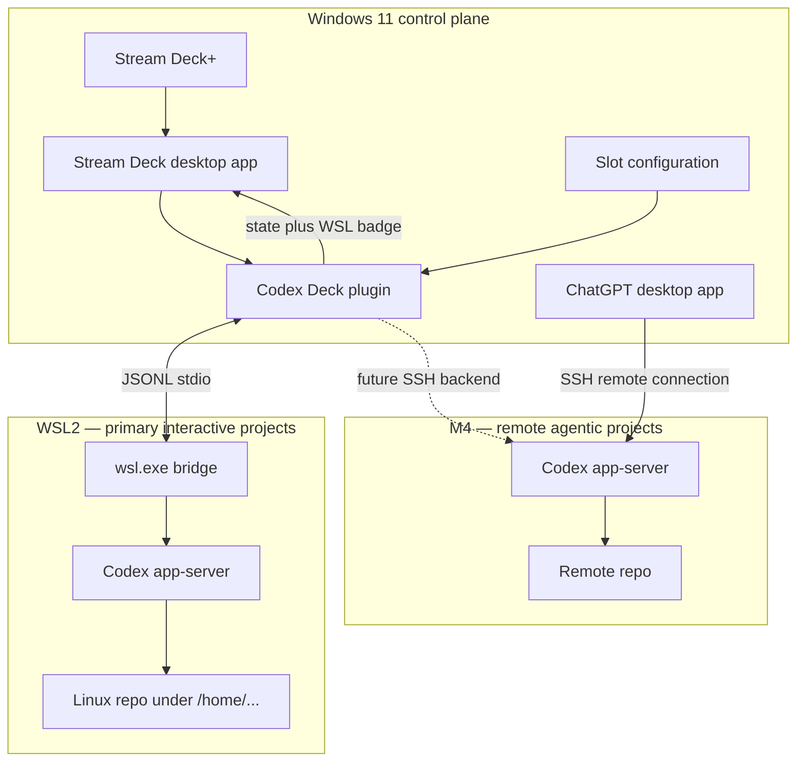
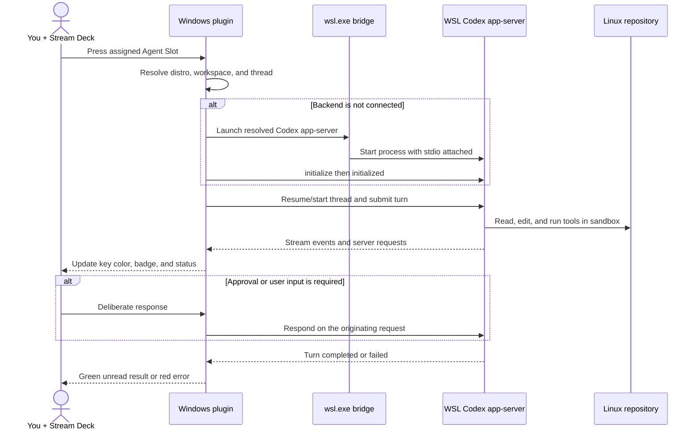

# WSL2 workflow

This document defines the implemented MVP workflow for Codex Deck. It covers the
Windows control plane, WSL2 interactive execution plane, and M4 remote execution
plane.

## System workflow

The Stream Deck plugin never enters WSL as a GUI component. It stays native and
uses `wsl.exe` as a transparent process bridge. The local WSL app-server and M4
app-server have separate identities, authentication, threads, and paths.

## Agent Slot interaction

## Slot lifecycle

1. A slot is configured with `wsl`, distribution, absolute Linux workspace,
   label, and optional thread ID.
2. A key press asks `BackendManager` for that distribution's connection.
3. If missing, the manager discovers Codex, starts `wsl.exe`, and performs the
   app-server handshake.
4. The client resumes the persisted thread or creates one, then sends the turn.
5. Streamed events update the physical key and later the touch strip.
6. Pending requests remain attached to the originating backend and turn.
7. Completion becomes green/unread; viewing it returns the slot to white/idle.
8. WSL shutdown becomes red/offline; the next action reconnects and resumes.

## Failure behavior

| Failure | Surface behavior | Recovery |
| --- | --- | --- |
| Distribution missing | Red `WSL?` badge | Re-select an installed distribution. |
| Codex missing or unauthenticated | Red `AUTH` badge | Install or run `codex login` inside WSL. |
| Workspace is not an absolute Linux path | Reject settings | Choose a `/home/...` directory. |
| WSL/app-server exits | Red `OFF` badge | Reconnect on the next action and resume thread. |
| Approval or question pending | Amber `WSL` badge | Show origin and require deliberate input. |
| Unknown protocol event | Amber diagnostic state | Preserve event metadata; do not guess a response. |

## MVP boundary

Version 0.2 implements local WSL transport, reconnection, Linux-path validation,
backend-aware status, six agent slots, four dials, touch-strip feedback, and
connection-bound approval/decline controls. It intentionally leaves remote M4
Stream Deck control, free-form question answering, voice input, and Windows
desktop shared-server control for later releases. UI automation remains outside
the design.
